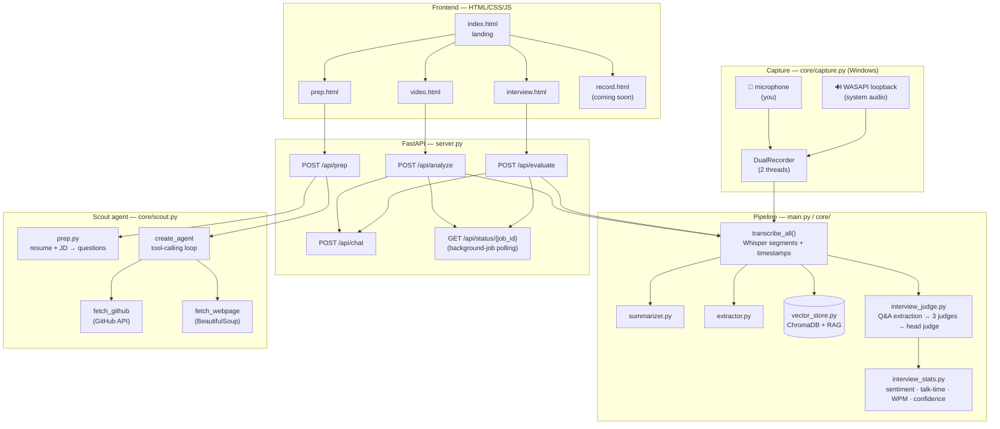

# ✦ VoxNote AI — Video Intelligence Studio

Turn hours of video into clear thinking: timestamped transcripts, executive summaries,
and a **3-judge AI panel** that scores your interview answers like the real thing.


---

## What it does

Four modes, one app:

| Mode | What happens |
|---|---|
| 📹 **Video Intelligence** | Paste a YouTube link or upload a recording → transcript, executive summary, action items, key decisions, open questions, plus a RAG chat ("ask your video") |
| 🎯 **Interview Evaluator** | Upload an interview recording → a panel of three AI judges scores every answer on technical correctness, communication, and depth → head judge delivers the verdict with timestamps, plus sentiment, talk-time, WPM, and confidence stats |
| 📋 **Interview Prep** | Upload your resume + paste a job description → tailored interview questions (easy→hard), a scored GitHub profile review, and an AI **scout agent** that visits the links in your resume and judges each one |
| ● **Live Capture** *(coming soon)* | Record mic + system audio during a real class/meeting — no bots joining your calls |

---

## Architecture



**Request flow:** the browser posts a job → FastAPI runs it as a background task → the
frontend polls `/api/status/{job_id}` until it's complete. Long work (transcription,
judging) never blocks HTTP.

---

## The judge panel

One prompt trying to grade everything produces muddled feedback. VoxNote splits the job
the way real interview panels work:

```
Q&A extraction → ┌─ Technical judge ──────┐
                 ├─ Communication judge ──┤ → Head judge → verdict + stats
                 └─ Depth judge ──────────┘
```

- **Technical judge** — is the answer correct? (`correct` / `partially_correct` / `incorrect`)
- **Communication judge** — clarity, structure, conciseness, confidence
- **Depth judge** — trade-offs, real examples, "why" not just "what"
- **Head judge** — weighs the three (50/25/25), resolves disagreements, writes actionable feedback

**Design rule used throughout:** *agents where decisions or tools are needed; chains where
the path is fixed.* The judge panel is deterministic chains — no tool choices to make.
The scout agent is a genuine `create_agent` tool loop — resume links are unpredictable,
so the LLM must decide which links to visit and which tool fits each one.

---

## The capture trick

Speaker diarization with ML is heavy and error-prone. VoxNote cheats — honestly:

- **Mic channel** = you (the interviewer)
- **System-audio channel** (WASAPI loopback via `pyaudiowpatch`) = them (the candidate)

Two channels = free speaker separation. Each stream is transcribed separately and tagged,
so questions and answers attribute correctly with zero diarization models.

---

## Tech stack

| Layer | Choice |
|---|---|
| Transcription | OpenAI Whisper, running locally (timestamps preserved) |
| LLM | GPT-6 Luna via `langchain-openai` |
| Embeddings / vector DB | `sentence-transformers` + ChromaDB |
| Orchestration | LangChain chains + `create_agent` |
| Backend | FastAPI (background jobs + polling) |
| Frontend | Vanilla HTML/CSS/JS |
| Capture (Windows) | `sounddevice` (mic) + `pyaudiowpatch` (WASAPI loopback) |
| PDF / web | `pypdf`, `requests` + `BeautifulSoup` |

---

## Quickstart

```bash
# 1. Install (use your project's venv)
uv pip install fastapi uvicorn python-multipart langchain langchain-openai \
  openai whisper pydub yt-dlp chromadb sentence-transformers \
  sounddevice pyaudiowpatch soundfile numpy pypdf requests beautifulsoup4 python-dotenv

# 2. Configure
cp .env.example .env   # then add your OPENAI_API_KEY
```

`.env`:
```env
OPENAI_API_KEY=sk-your-key-here
# JUDGE_MODEL=gpt-6-luna        # override only if OpenAI lists it under another ID
# WHISPER_MODEL=small           # base = faster, medium = more accurate
# SARVAM_API_KEY=...            # only for "hinglish" transcription
```

```bash
# 3. Run
uvicorn server:app --reload
# open http://localhost:8000
```

**Record from your PC (Windows):**
```bash
python -m core.capture devices   # check mic + loopback are detected
python -m core.capture           # record until ENTER
```

**CLI pipeline (no web UI):**
```bash
python test.py
```

---

## Project structure

```
├── server.py              # FastAPI: jobs, polling, serves frontend/
├── main.py                # run_pipeline(): audio → transcript → insights
├── core/
│   ├── transcriber.py     # Whisper segments with timestamps preserved
│   ├── interview_judge.py # Q&A extraction + 3-judge panel + head judge
│   ├── interview_stats.py # sentiment, talk-time, WPM, confidence
│   ├── capture.py         # dual-channel Windows recording
│   ├── prep.py            # resume + JD → tailored questions, GitHub review
│   ├── scout.py           # profile-scout agent (create_agent + tools)
│   ├── summarizer.py      # map-reduce summaries + titles
│   ├── extractor.py       # action items, decisions, open questions
│   ├── vector_store.py    # ChromaDB embeddings
│   └── rag_engine.py      # transcript RAG chat
├── utils/
│   └── aduio_processor.py # yt-dlp / upload → 16kHz mono WAV chunks
└── frontend/
    ├── index.html         # landing: 4 mode cards
    ├── video.html         # video intelligence + RAG chat
    ├── interview.html     # judge dashboard + stats + chat
    ├── prep.html          # interview prep + scout report
    ├── css/styles.css
    └── js/
```

---

## Design decisions (interview-ready)

- **Why 3 judges + head judge?** Separation of concerns — one prompt doing everything gives generic feedback. Mirrors real panels: specialists score, a hiring manager decides.
- **Why chains, not agents, for judging?** The path is fixed (extract → judge → aggregate). No tool decisions exist, so an agent loop would add nothing.
- **Why an agent for the scout?** Resume links are unpredictable. The agent decides which links deserve a visit and which tool fits — that's the actual definition of agentic behavior.
- **Why segment-level (not word-level) timestamps?** Enough precision to attribute answers; word-level adds complexity for zero benefit here.
- **Why background jobs + polling?** Transcription takes minutes. Blocking HTTP that long is fragile; jobs + polling is the standard pattern.
- **Why FastAPI + plain HTML over Streamlit?** Full design control, and the API can later serve a mobile app or the capture client without rewriting.
- **Why no `temperature` param?** GPT-6 Luna rejects it — the model doesn't accept temperature overrides.

---

## Roadmap

- [ ] Live Capture page wired to `DualRecorder` (record from the browser)
- [ ] True per-speaker stats from dual-channel recordings
- [ ] Timestamp citations in RAG chat answers (`[04:24]`-style, AskFred parity)
- [ ] Real-time interview scoring (streaming transcription + live judging)

---

## Ethics

Recording laws vary — many places require **all parties to consent**. Tell people you're
recording before you start. This tool is for your own meetings, classes, and interviews
where everyone has agreed. AI scores are assistive, not authoritative — always apply
human judgment to hiring decisions.

---

Built by [Amit Saha](https://github.com/amitsaha09) — learning agentic AI by shipping it.
